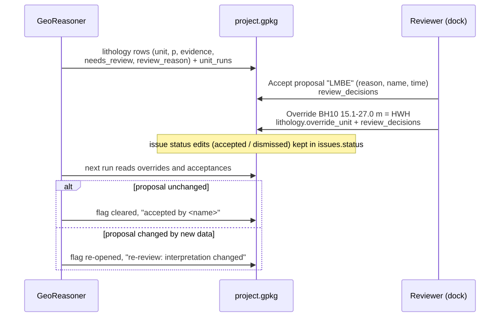

# Architecture

## Goals that shape the design

| Requirement | Architectural answer |
|---|---|
| Geologically defensible, not geometric | interpretation (GeoReasoner) is a separate stage that produces *typed* observations; the modeller only ever sees contacts between units the reasoner placed in a valid order |
| Transparent, reproducible | pure functions over explicit configuration dataclasses; every run records inputs hash, configuration, knowledge-base version and seed (`model_runs`) |
| Usable without QGIS (CI, servers, notebooks) | **headless core** (NumPy + standard library) with optional dependencies loaded lazily (`core/optional.py`) |
| First-class QGIS integration | **thin shell** (`plugin.py`, `gui/`, `algorithms/`) that only adapts the core: every GUI action is also a Processing algorithm, and both call the same `workflows.py` / `pipeline.py` functions |
| Open data, no lock-in | one OGC GeoPackage per project written with `sqlite3` only (R-tree triggers, `gpkg_*` tables); GeoTIFF/2DM rasters; standard 3D formats |
| Maintainability | stratigraphy as **data** (JSON knowledge base + province columns) not code; schema migrations; service endpoints as a registry; ~140 automated tests including a QGIS suite |



## Layers

```
agsgeomodel/
├── plugin.py, gui/, algorithms/        QGIS shell (imports qgis.*)
├── workflows.py, pipeline.py, __main__  orchestration shared by GUI, Processing and CLI
├── core/          config dataclasses, errors, issues, provenance, geometry, grid, contours,
│                  spatial index, CRS transformations, optional dependencies
├── models/        data model: Location, Interval, SPT/CPT, water, samples, lab, faults, map units
├── importers/     AGS4/AGS3 reader, validator, dictionary, CRS/datum detection, mapper;
│                  CSV, Excel, LAS, LandXML, ASCII grid, GeoJSON, GeoPackage, Shapefile, DXF
├── geology/       knowledge base + province columns, description parser, classifier,
│                  sequence inference, contacts, validation rules, domains, GeoReasoner
├── modelling/     variograms, kriging, RBF/IDW/TIN, fault barriers, inequality constraints,
│                  uncertainty classes, stochastic simulation, model builder, GemPy adapter
├── processors/    CPT, SPT, engineering ground model
├── hydrogeology/  heads, confinement, flow, seepage, hydrostratigraphic units
├── hdd/           bore profiles, ground-risk assessment, long sections
├── bgs/           HTTP cache, service registry, OGC API / AGS API connector, borehole ranking
├── ai/            features, trainable formation model, similarity, clustering
├── correlation/   five correlation modes
├── visualisation/ drawing (SVG/PDF), sections, fences, colours
├── exports/       meshes and 2D/3D writers
├── database/      GeoPackage, rasters, schema and migrations, ProjectStore
├── reports/       HTML report
└── examples/      synthetic site with analytic truth (NOT REAL DATA)
```

The import rule is strict: nothing outside `gui/`, `algorithms/` and `plugin.py` imports `qgis`. The
QGIS shell hands the core two hooks at start-up (`gui/qgis_bridge.install`): a coordinate-transformer
factory backed by `QgsCoordinateTransform` (so PROJ grids such as OSTN15 configured in QGIS are used) and an
HTTP fetcher backed by `QgsBlockingNetworkRequest` (QGIS proxy and authentication). Without QGIS the core
uses `pyproj` or a documented Helmert approximation, and `urllib`.

## Data flow



1. **Import** (`importers/ags`): bytes → `AGSFile` (groups, headings, units, types, line numbers) →
   `ValidationReport` (never raises on findings) → `Project` in the project CRS, with the CRS and datum
   evidence kept in `project.metadata`.
2. **Interpretation** (`geology/reasoner.py`): per hole, an order-constrained HMM over the province column
   (see [geological rules](geological_rules.md)) produces unit runs with probabilities, alternatives and
   evidence; a second pass adds leave-one-out elevation priors from neighbours. Output: a
   `ProjectInterpretation` with typed observations (equalities, bounds, isochores) and findings.
3. **Modelling** (`modelling/builder.py`): cover sequences as thickness fields, rockhead, a reference
   bedrock surface with inequality constraints, fault barriers and map constraints, isochore stacking and
   residual kriging, then uncertainty classes and (optionally) conditional realisations.
4. **Engineering, groundwater, HDD**: CPT/SPT interpretation, ground-model statistics per unit, head
   surfaces per aquifer system and confinement, HDD station assessment.
5. **Persistence and outputs** (`database/store.py`): everything goes to `project.gpkg`; drawings, exports
   and the report are files next to it.

## Key design decisions

**Order-constrained inference instead of free classification.** A classifier alone can assign *London
Clay* below *Thanet Sand*. The GeoReasoner decodes each hole as a path through the stratigraphic column, so
impossible sequences have zero probability (unless the reviewer explicitly allows structural repetition
for a hole) and every deviation from the logger's codes becomes a finding.

**Typed observations.** A hole that stops in a unit only gives a bound (the base is deeper than the end of
the hole); a unit that is absent between two others gives an equality at zero thickness; an erosional
contact truncates. The modeller treats these differently (equalities, active-set inequality constraints,
truncation), which is why holes that do not reach a contact still constrain it.

**Cover as thickness, bedrock as stack.** Superficial deposits are modelled as non-negative thickness
fields below the ground surface; the rockhead follows. Bedrock is a reference surface plus isochores of the
intermediate units, then a residual correction honours every contact. This keeps units from crossing and
lets uncertainty propagate down the stack.

**Uncertainty everywhere, in the data model.** Standard deviation, confidence and class are stored for
every surface node and carried to sections, HDD stations, the report and exports; drawings encode the class
in the contact line style.

**Reviewer decisions as data.** Overrides (`lithology.override_unit`) and acceptances
(`review_decisions`) are stored, applied before each run, and an acceptance lapses automatically when the
proposal changes, so a reviewed project stays consistent as data are added.



**Pluggable backends.** Interpolation methods share one interface (`fit`/`predict` with standard
deviation); learned formation models share the `LearnedModel` protocol; GemPy plugs in through an adapter.

## Threading

Long work runs in `QgsTask`s (`gui/tasks.py`) or Processing threads. The core never touches QGIS objects
from worker threads: the transform context is cached on the main thread, the HTTP cache uses a locked
SQLite connection, and each operation opens its own GeoPackage connection.

## Performance

* Description parsing and evidence are cached per unique description; sequence inference is vectorised.
* Neighbour searches use a KD-tree (SciPy) or an exact bucket grid; kriging is solved in chunks of
  prediction nodes with local neighbourhoods; independent surfaces are built in parallel threads.
* Typical figures (laptop, NumPy only): 100 000 logged intervals in 1 000 holes interpreted in about
  25 s; a 5 m-grid model of those holes in about 12 s; the synthetic example end to end in about 20 s.
  See [verification](verification.md).

## Compatibility

* QGIS 3.40+ (tested 3.40.3). Qt code uses `qgis.PyQt`, fully qualified enums (`Qt.ItemFlag.ItemIsEnabled`),
  `exec()` and `Qgis.*` enums so it can move to Qt6 / QGIS 4; QGIS 4 itself has not been tested, so the
  plugin metadata declares QGIS 3.40-3.99.
* 3D uses vector 3D renderers (`QgsRuleBased3DRenderer` with line, polygon and point symbols), which are
  available in all QGIS 3.40 builds; mesh layers are added for 2D use.
* GeoPackage filters are put in the layer URI (`|subset=`), which avoids an issue some GDAL/SQLite builds
  have with `setSubsetString` on several layers of one GeoPackage.
