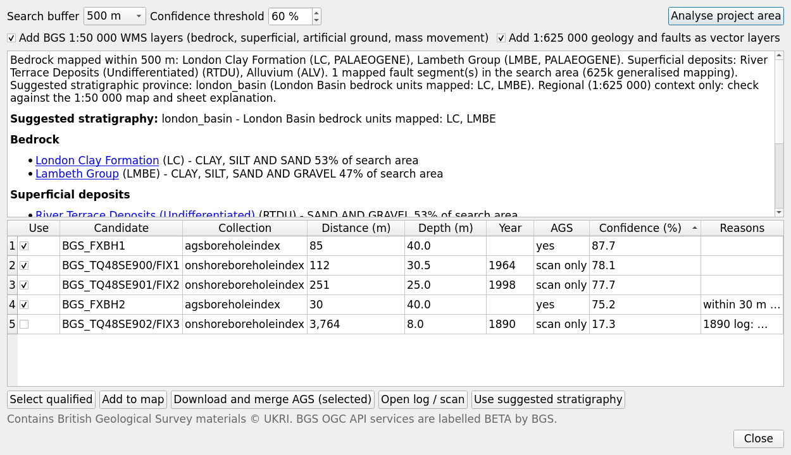

# BGS integration

The BGS dialog (toolbar **BGS…**) and the *BGS geology and borehole discovery* algorithm put a project in
its regional geological context using British Geological Survey open services, and find BGS borehole
records that can fill gaps in the site investigation. Retrieved data are always kept separate from the
project's own data: they are secondary control, weighted by an explainable confidence, and they can never
make a model node *Observed*.

## Services

| Service | Endpoint | Used for |
|---|---|---|
| BGS OGC API - Features (**BETA**) | `https://ogcapi.bgs.ac.uk` | Geology 625k bedrock, superficial deposits, faults and dykes; Single Onshore Borehole Index; AGS borehole index; landslide index; scanned 1:250k / 1:500k map sheet index |
| BGS AGS API | `https://agsapi.bgs.ac.uk/v7` | download of AGS data held by BGS (`/ags_export/`, up to 50 boreholes per request, ZIP) and links to logs (`/ags_log/`) |
| BGS Lexicon of Named Rock Units | `webapps.bgs.ac.uk/lexicon` and `data.bgs.ac.uk/id/Lexicon/NamedRockUnit/{code}` | links from every unit to its Lexicon definition |
| BGS 1:50 000 geology WMS | `map.bgs.ac.uk/arcgis/services/BGS_Detailed_Geology/MapServer/WMSServer` | background layers (bedrock, superficial deposits, artificial ground, mass movement) |

Endpoints are a registry (`bgs/services.py`), not code: they were checked against the live services in
October 2026, and any of them can be overridden in **Settings › BGS services** without a new release. BGS
labels the OGC API as BETA ("endpoints and attributes could change"). No hydrogeology endpoint is built
in: a hydrogeology or aquifer-designation WMS can be configured if you are licensed to use one (in England
the Environment Agency aquifer designations are the authoritative source).

All requests go through QGIS's network stack (proxy and authentication settings apply) and an on-disk
cache (`~/.agsgeomodel/http_cache.sqlite` by default, 30 days). In **offline mode** only cached responses
are used, so a project can be re-run and reviewed later with exactly the data used at the time; the cache
key and retrieval time are recorded in the provenance.

## 1. Area analysis

For the extent of the project's holes and a buffer (100 m to 5 km, default 500 m), the connector
retrieves and summarises:

* the **bedrock** and **superficial** map units within the buffer, with their approximate area fractions
  and Lexicon links;
* **faults** (625k linework) and the **landslide** index;
* **map sheets** covering the area (citations for the report);
* a suggested **province column**: London Basin units (Palaeogene and Chalk) give `london_basin`, and with
  glacial deposits (Lowestoft Formation, glacial sand and gravel) `east_anglia_glacial`. When no bundled
  column matches, the analysis says so: create a project column (see
  [geological rules](geological_rules.md#7-extending-the-rules)) before relying on the GeoReasoner.

BGS Geology 625k is **generalised**. Each polygon carries a positional tolerance of about 0.5 mm at map
scale (about 300 m), which the model builder honours when map constraints are used; map units therefore
only add soft "present / absent" constraints and never override logged holes. For site-scale work, view
the 1:50 000 WMS layers alongside.

## 2. Borehole discovery and confidence

Records from the Single Onshore Borehole Index (scanned logs) and the AGS borehole index (AGS data held by
BGS) near the site are ranked by a **confidence** (0-100 %) from six factors, combined as a weighted
geometric mean so that one very poor factor cannot be compensated by the others:

| Factor | Weight | Score |
|---|---|---|
| proximity | 1.0 | exp(−d / 250 m), d = distance to the project area (0 inside the buffer polygon) or to the alignment |
| gap value | 0.8 | distance to the nearest project hole relative to the median hole spacing, clipped to 0.15-1 (a record next to an existing hole adds little) |
| geology | 1.2 | 1.0 when the mapped unit at the record agrees with the modelled rockhead unit, 0.45 when it does not (map generalisation, fault or misidentification), 0.8 / 0.7 when it cannot be checked |
| elevation | 0.6 | recorded ground level against the DTM (1 − Δz / 3 m, at least 0.3); 0.8 when the level is taken from the DTM |
| age | 0.6 | 1.0 from 1990, 0.8 from 1960, 0.6 from 1900, 0.45 older or unknown (old logs use superseded terms such as *Woolwich and Reading Beds*) |
| quality | 1.2 | AGS data 1.0, scanned log 0.65; × positional precision (≤ 1 m: 1.0, ≤ 10 m: 0.85, ≤ 100 m: 0.55, coarser: 0.3); × depth reached / depth needed |

Records at or above the **threshold** (default 60 %) are proposed. Every candidate shows its breakdown and
the reasons that lowered it ("within 12 m of a project hole: little gap value", "1952 log: check
terminology", "recorded ground level differs from DTM by 1.8 m"), and the candidates are written to the
GeoPackage (`bgs_boreholes`, with `score_breakdown`) so the selection can be reviewed later.

## 3. Using BGS records

* **AGS data held by BGS**: select candidates (*Select qualified* selects those above the threshold) and
  choose *Download and merge AGS (selected)*. Files are stored unchanged in
  `<project>/bgs_ags/` and registered in the project configuration as `secondary_ags` with the
  per-location confidence. On the next run they are imported with `source = BGS_AGS`,
  `quality = confidence / 100` and IDs prefixed `BGS:`.
* **Scanned logs** (borehole index records without AGS data): open the scan from the candidate's link and,
  if it is needed, transcribe it as AGS; register the file as a secondary AGS input with the candidate's
  confidence and it enters the project like any other secondary record.
* **Map units and faults**: *Add 1:625 000 geology and faults as vector layers* adds them to the map; they
  can then be chosen as model inputs in the project panel (faults as barriers, map polygons as
  constraints). *Add BGS 1:50 000 WMS layers* adds the detailed geology as background.
* **Stratigraphy**: *Use suggested stratigraphy* sets the suggested province column in the project panel.

In the model, contacts from secondary data get σ = max(primary σ / q, secondary σ / q) with q the quality
(so at least 1 m by default, more for low confidence), they are classified *Inferred* at best, and the
GeoReasoner treats their descriptions with the same order constraints as the project's own holes. The
report lists every BGS record used, with its confidence.

Merging never changes the project's own AGS data, and the secondary files can be removed from the
configuration (`secondary_ags`) at any time to compare models with and without them.

## Licence and attribution

BGS map and borehole index data are available under the Open Government Licence. Every result carries the
attribution *Contains British Geological Survey materials © UKRI <year>*, which the plugin adds to the
metadata of BGS layers, to the area analysis and, when BGS records are used, to the report's list of
secondary data. Keep it with any map or export that shows BGS data. Check the licence of each dataset before redistribution; borehole
records supplied to BGS by third parties may carry additional conditions, which are stated on the BGS log
pages.

## Testing without a network

The test suite routes BGS requests to fixtures (`tests/fixtures/bgs_fixtures.py`) through a fake fetcher,
so it runs offline. The fixtures follow the structure of the OGC API and AGS API responses but their
content is synthetic: they are not real BGS records around the example site.
