# Geological rules and the GeoReasoner

The GeoReasoner turns logged strata into an interpretation that respects the stratigraphy of the area:
units in their order of superposition, unconformities where they belong, facies sequences where order is
not fixed, missing units where the column says they can be missing. It never edits the data; it
interprets them and reports every conflict with candidate explanations.



## 1. Knowledge base

`agsgeomodel/geology/knowledge/data/uk_units.json` holds one record per unit, keyed to its **BGS Lexicon
code** (or the code used in BGS Geology 625k for generalised map units such as RTDU, THAM): name, Lexicon
parent, rank, class (artificial / superficial / bedrock), domain, material, age range, environment,
hydrogeological character, aliases (historical and logging names, e.g. *Woolwich and Reading Beds* for the
Lambeth Group), typical and maximum thickness, colour, hazard flags (obstructions, running sand, boulders,
hard bands, flints, dissolution…) and a **description signature** (weights for description features, see
§3). The [knowledge base reference](reference/knowledge_base.md) lists every unit.

Lexicon codes used were checked against the BGS Lexicon (e.g. `LMBE` Lambeth Group; `WL` is the Woolwich
Formation, while `WOO` is the Woodhall Marine Band; `RB` is the Reading Formation, `REA` a duplicate code).
Units can be added or adjusted without code changes; `KnowledgeBase.validate()` and
`StratColumn.check_age_order()` reject inconsistent files.

## 2. Province columns

`data/provinces/<id>.json` defines the local stratigraphic column as an ordered list of **sequences**:

| Field | Meaning |
|---|---|
| `kind` | `artificial`, `superficial` or `bedrock` |
| `order` | `strict`: superposition order is fixed (bedrock); `facies`: units may occur in other orders (fluvial, glacial, slope deposits); `typical_order` and `free_pairs` describe what is usual, `repeatable` allows repetition (e.g. till / outwash) |
| `units` | code, **presence** probability (regional prior), mean and SD thickness |
| `relations` | contact type between consecutive units (conformable / unconformable) with notes, e.g. *HWH on LMBE: eroded unconformity, basal flint lag* |
| `base` | how the sequence's base is treated (`erosional` for cover sequences, `model_base` for the lowest bedrock) |
| `aquifer_systems` | hydrostratigraphy: units of each system, its aquifer units and its confining units |
| `max_apparent_dip_deg`, `rockhead_max_apparent_dip_deg` | limits used by the correlation checks |
| `repetition_explanations` | geological explanations offered when a sequence appears repeated or inverted |

Bundled columns: `london_basin` (central and eastern London Basin, Palaeogene over Chalk with fluvial and
estuarine cover) and `east_anglia_glacial` (London Basin margin with Anglian glacial cover, north Essex /
south Suffolk). Their presence probabilities and thicknesses are **regional priors**: replace them with
site values from the BGS sheet explanation, memoir and nearby records for a real project.

Between sequences the order is always strict (artificial over superficial over bedrock). Every contact
from a cover sequence onto bedrock is **erosional** (rockhead).

## 3. Evidence from descriptions and codes

`description.py` parses BS 5930 / BS EN ISO 14688-14689 style descriptions into features:

| Prefix | Examples |
|---|---|
| `pt:` principal constituent | `pt:clay`, `pt:sand`, `pt:gravel`, `pt:chalk`, `pt:peat`, `pt:made_ground` |
| `sec:` secondary constituents | `sec:sandy`, `sec:gravelly`, `sec:organic`, `sec:silty` |
| `cons:` / `dens:` | consistency (soft … very stiff), density (loose … very dense) |
| `col:` | colour terms (grey, brown, green, mottled, …) |
| `struct:` | fissured, laminated, structureless, putty, … |
| `incl:` | inclusions: selenite, glauconite, flint, shells, pyrite, brick, ash, rootlets, … |
| `grain:` / `shape:` | particle size and shape |
| `chalk:` | CIRIA C574 chalk grade (A-D, Dm/Dc) |
| `geo:` | formation names in the text ("LONDON CLAY", "Thanet Sand"), with tentative terms ("possibly") weighted down |
| `rec:` | recovery statements ("No recovery", "Not logged") |

The **classifier** scores every unit of the column:

```
score(u) = τ · Σ_f w_f · signature_u(f)                         description features (τ = temperature, 1.0)
         + stated evidence   GEOL_BGS (+4), GEOL_GEOL via codes and aliases (+3), GEOL_GEO2 (+1.5),
                             names in GEOL_FORM or in the description text (+3),
                             halved when tentative ("?", "possibly", "probably")
         + learned model     centred log-probabilities, probabilities floored at 0.0025 (optional, see ai.md)
```

Scores are log-likelihood points; only differences matter. Every contribution is stored as an evidence
item (`feature`, `unit`, `weight`), so each interpretation can be explained term by term, e.g.
`GEOL_BGS=TAB (+4.0), geo:TAB (+3.0), pt:sand (+1.8), dens:very_dense (+1.0)`.

## 4. Order-constrained sequence inference

Each hole is decoded as a path through the column with a hidden Markov model whose states are the units
in stratigraphic order:

* **Transitions only go down the column.** Within a strict sequence the next unit below `a` can be any
  lower unit `b`; skipping intermediate units costs their presence probabilities
  (`P ∝ presence(b) · Π_c between (1 − presence(c))`), so a usually-present unit is rarely skipped without
  evidence. Facies sequences allow atypical orders at `reverse_order_weight` (0.25), and any order for
  pairs the province lists as `free_pairs` or for repeatable sequences. Moving back up the column
  (structural repetition: reverse fault, glacial raft) is impossible unless the hole is listed in
  `allow_repetition` (a reviewer decision recorded in the settings), and then only at
  `repetition_probability` (1e-4) per move.
* **Staying in a unit** decays with thickness relative to the unit's mean thickness; at a boundary drawn
  by the logger a change of unit is a priori likelier (`stay_base` 0.85).
* **Unlogged intervals** (no recovery, not described) longer than 1.5 × `unknown_split_m` are split into
  slices of about `unknown_split_m` (1 m) with uninformative evidence, so the model can place a boundary
  (and a missing unit) inside them; inside such a gap the thickness model applies on its own.
* **Elevation priors** (second pass): leave-one-out predictions of rockhead and bedrock contacts from
  neighbouring holes add a bonus to units whose expected elevation range contains the slice
  (σ = `neighbour_elevation_sigma_m`, 3 m).

Forward-backward gives posterior probabilities per slice; the reported path is the
**maximum-expected-accuracy** path (the order-consistent path that maximises the expected number of
correctly labelled metres). Unlike the Viterbi path (kept for reference) it is not biased against
boundaries inside unlogged intervals, which matters for missing-layer inference. Consecutive slices with
the same unit become **unit runs** with a thickness-weighted probability; each logged interval gets its
dominant unit, probability, alternatives, evidence and status:

| Status | Meaning |
|---|---|
| `stated` | the logger's formation was adopted (consistent with the sequence) |
| `classified` | inferred from the description evidence |
| `inferred` | no usable description: from stratigraphic order and neighbours |
| `overridden` | a named reviewer assigned the unit |

An interval is flagged for review when its probability is below `review_below_probability` (0.6), when it
has no description evidence, or when an unlogged interval was split between units. A reviewer acceptance
clears the flag while the proposal (the unit sequence of the interval) is unchanged.

## 5. Contacts for modelling

`contacts.py` turns unit runs into typed observations:

| Contact | Observation |
|---|---|
| between consecutive units of a strict sequence | equality at the base of the upper unit (`conformable`, or `unconformable` per the column's relations) |
| cover on bedrock | `erosional` rockhead equality; bedrock surfaces above the first bedrock unit are truncated |
| unit skipped between two units | `absent`: the skipped unit's base equals its top (zero thickness) |
| hole ends inside a unit | `GE`/`LE` bounds: the unit's base is deeper than the end of the hole |
| facies sequence not fully penetrated | bound on the sequence thickness |
| contact inside an unlogged interval | equality flagged `inferred` with σ ≥ 1.5 m |
| thickness of intermediate bedrock units | isochore observations (`iso:<unit>`) used for stacking |

Each observation carries σ: 0.15 m for AGS contacts (levelling and logging), at least 1 m for BGS or legacy
records (scaled by the candidate confidence), 2 m for map linework.

## 6. Rule catalogue

All rules return findings (`issues` table) with severity, hole(s), depth, message, candidate explanations
and a suggested action. None of them modify data.

| Rule | Severity | Checks | Typical explanations |
|---|---|---|---|
| GEO-INV-01 | error | logged formation codes violate superposition | logging or classification error; reworked material; reverse faulting or folding; landslip / cambering |
| GEO-INV-02 | warning | descriptions indicate an older unit above younger ones (repeated / inverted sequence) | as above; glacial raft (glacial provinces) |
| GEO-CON-01 | warning | stratigraphic order overrides strong description evidence (margin in log-units given) | reworked or transitional material; local facies; misdescription |
| GEO-STA-01 | warning | logged formation conflicts with the consistent interpretation | wrong code; mis-correlated log |
| GEO-OMI-01 | warning | a usually-present unit is missing between two units | erosion / unconformity; condensed sequence; not recognised in the log |
| GEO-MIS-01 | warning / info | unlogged interval: inferred sequence (accept / reject in the review panel) | |
| GEO-THK-01 | warning | unit thicker than its known maximum | channel or scour fill; repeated section; wrong unit |
| GEO-LOW-01 | info | interpretation probability below the review threshold | |
| GEO-DIP-01 | warning (info across a mapped fault) | steep apparent dip on a conformable bedrock contact between neighbours | fault between the holes; channel or erosion surface; misidentified contact; levelling or depth error |
| GEO-DIP-02 | info | steep rockhead between neighbours | scour hollow / buried channel; dissolution pipe (Chalk at rockhead); levelling or depth error |
| GEO-ELV-01 | warning (info across a mapped fault) | a unit in one hole extends below the top of an underlying unit in a neighbour by more than the dip limit allows | possible fault; erosion / channel; logging or levelling issue |
| GEO-LOO-01 | warning | contact elevation anomalous relative to its neighbours (leave-one-out, not across faults) | levelling error; misidentified contact; local structure |
| GEO-LOC-01 | error | strata reference an unknown location | |
| GEO-LOC-02 | warning | location without ground level: excluded from interpretation and modelling | |

AGS format rules (AGS4-1 … AGS4-20) and engineering checks (E00-E15) are listed in
[AGS support](ags_support.md).

## 7. Extending the rules

* **New unit**: add a record to `uk_units.json` (Lexicon code, ages, signature, thickness, colour, hazards),
  then reference it from a province column. Run `pytest tests/unit/test_geology.py`.
* **New province**: copy a province file, list the sequences top-down with presence and thickness priors
  from the BGS sheet explanation / memoir, and the aquifer systems. `load_column()` checks unit codes and
  age order.
* **Project aliases**: logging codes specific to a contractor can be mapped with `code_aliases` (e.g.
  `{"LCL": "LC"}`) passed to the GeoReasoner.
* **New rule**: add a function to `geology/validation.py` returning `Issue` objects with explanations and a
  test in `tests/unit/test_geology.py`; document it in the table above.
