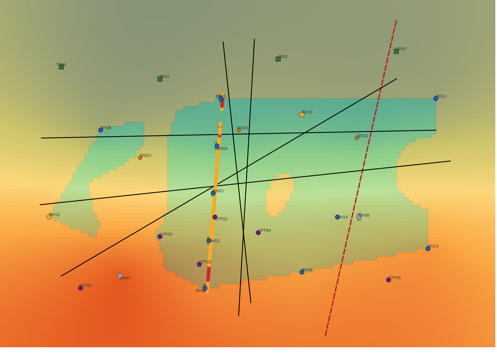

# AGSGeoModel

Defensible geological interpretation and 3D ground models from AGS4 ground investigation data, in QGIS.

AGSGeoModel imports and validates AGS data, interprets every logged stratum against the local
stratigraphic column (keyed to BGS Lexicon codes), builds a geologically constrained model with faults,
map constraints and uncertainty classes, and produces sections, fence diagrams, HDD long sections with a
ground-risk assessment, groundwater surfaces, engineering parameters, exports and a report. Reviewer
decisions are stored with the project, and nothing in the data is changed behind the user's back.



```{toctree}
:maxdepth: 2
:caption: Using AGSGeoModel

installation
user_guide
examples
reference/processing
```

```{toctree}
:maxdepth: 2
:caption: How it works

architecture
geological_rules
methods
ags_support
bgs_integration
ai
verification
```

```{toctree}
:maxdepth: 2
:caption: Reference and development

reference/data_model
reference/knowledge_base
api
developer_guide
roadmap
changelog
```
