# Methods

This page documents how the model, its uncertainty and the engineering outputs are computed, with the
parameters that control each step and the references they follow. Defaults are those of the shipped
configuration (`core/config.py`); all of them can be changed in **Settings** or in
`agsgeomodel_project.json`, and every run records the configuration it used.

## 1. Model domain

* **Extent**: the bounding box of the exploratory holes (and alignments / DTM coverage) plus `buffer_m`
  (250 m). Everything outside the convex hull of the data is extrapolation and is classified accordingly.
* **Grid**: regular 2D grid of `cell_size_m`; by default about 150 cells across the longer side. Model
  surfaces are stored as GeoTIFF (and MDAL 2DM meshes) per surface with matching standard-deviation,
  confidence and class rasters.
* **Ground**: the DTM (ASCII grid, GeoTIFF via GDAL, LAS point cloud, LandXML TIN) resampled to the grid;
  without a DTM, collar levels are interpolated. Collar levels that disagree with the DTM by more than
  the tolerance are reported (AGS validation E-checks).

The model is **2.5D**: every surface is single-valued in elevation, and faults are vertical in plan.
Overhangs, recumbent folds and dipping faults need the optional GemPy backend (§7).

## 2. Interpolation

| Method | Use | Standard deviation |
|---|---|---|
| **Ordinary kriging** (default) | all surfaces | kriging variance (with measurement error) |
| Universal kriging (`drift = linear`) | clear regional dip, extrapolation needed | kriging variance |
| RBF (thin plate, linear, cubic, gaussian, multiquadric) | smooth deterministic surfaces | proxy, calibrated by leave-one-out |
| IDW (`idw_power` 2) | quick look | proxy, calibrated by leave-one-out |
| TIN (linear on a Delaunay triangulation) | reproduce data exactly | proxy, calibrated by leave-one-out |

**Variograms.** The experimental semivariogram (12 lag classes up to half the maximum distance) is fitted
by weighted least squares with Cressie (1985) weights N(h)/γ(h)², searching 40 ranges and solving nugget
and partial sill in closed form with non-negativity. `auto` chooses between spherical and exponential
models (the Gaussian model is available on request only: fitted to sparse borehole data it tends to give
unrealistically smooth surfaces and over-confident variances). With fewer than 8 data, fewer than 4 lag
classes or fewer than 30 pairs, a conservative model is **assumed** (spherical, range 60 % of the data
extent, sill at least the data variance and at least `var_floor`) and flagged `fitted = false` in the run
record and the report.

**Kriging.** Local neighbourhoods of `n_neighbours` (16) visible data per node; each datum's measurement
variance σᵢ² is added to the diagonal of the data covariance, so uncertain data are smoothed while
primary contacts are honoured to within their error. Default σ: 0.15 m for AGS-logged contacts,
1.0 m for BGS and legacy records (divided by the record's confidence), 2.0 m for contacts derived from
map linework, 1.5 m or more for contacts inferred inside unlogged intervals.

**Deterministic methods.** A standard-deviation proxy `σ(x) = σ_meas + s · d_nn(x)` (distance to the
nearest datum) is fitted so it matches the leave-one-out errors. Classes and confidence stay comparable
whichever method is chosen, but only kriging provides a model-based variance.

## 3. Faults

Fault traces (GeoJSON, Shapefile, GeoPackage, DXF, or BGS linework) act as **barriers**: a datum is used
for a prediction node only when the segment between them does not cross a fault.

* A fault with a known **throw** and downthrown side corrects data across it by the throw ("throw
  corrected"), so both blocks contribute. The correction applies to elevation fields only: thicknesses
  (isochores) and kriging residuals are not displaced, because faulting post-dates deposition.
* A fault of **unknown throw** is an absolute barrier.
* Cover sequences (artificial and superficial deposits) post-date faulting and are not displaced.
* The validation rules use the same faults: dips, overlaps and leave-one-out anomalies across a mapped
  fault are reported as information, not warnings ([geological rules](geological_rules.md)).

## 4. Building the stratigraphic model

The builder (`modelling/builder.py`) follows a fixed order, recorded in the run diagnostics:

1. **Ground** (§1).
2. **Cover** (artificial and superficial sequences) as **thickness** fields. The total thickness of each
   sequence is interpolated first (smoother and better constrained than its parts); unit thicknesses are
   interpolated, rescaled to sum to the total and stacked down from ground. Thickness fields are
   non-negative. Map polygons add "present" (at least `min_mapped_thickness_m`, 0.5 m) and "absent"
   constraints within `map_tolerance_m` of their boundaries (scale dependent: about 0.5 mm at the map's
   scale for BGS data). **Rockhead** = ground − cover.
3. **Bedrock** (strict sequences), `bedrock_method = isochore`:
   * a **reference surface** (the base with most observations, or `reference_surface`) is kriged with
     fault barriers and inequality constraints;
   * the other surfaces are obtained by **stacking isochores** (unit thicknesses, continuous across faults)
     up and down from the reference;
   * each stacked surface is then corrected by kriging its own residuals (fault barriers, no throw
     correction), so every observation is honoured within its σ;
   * surfaces are clamped so that they never cross.
   `bedrock_method = independent` kriges each base separately (useful for testing a stacking assumption).
4. **Inequalities** (holes ending inside a unit, units eroded at rockhead, map constraints) are honoured
   with an active-set approximation of inequality kriging (Journel 1986; Freulon & de Fouquet 1993): fit
   the equalities, add the most violated inequalities as pseudo-data at their bound, refit; at most
   `max_inequality_iterations` (8). Contradictory constraints remain violated and are reported.
5. **Erosion**: bedrock tops are truncated by rockhead; units are absent where the truncation removes
   them.
6. **Uncertainty** (§5) and optional **realisations** (§6).

## 5. Uncertainty, confidence and classes

Every surface node carries a standard deviation σ (kriging variance, or propagated along the stack: a
stacked surface combines the reference σ with the isochore σs), and

* **confidence** = exp(−σ / `confidence_scale_m`), with `confidence_scale_m` = 3 m;
* **RAG**: green for confidence ≥ 0.70, amber ≥ 0.40, red below;
* an **interpretation class**:

| Class | Rule (defaults) |
|---|---|
| **Observed** | within max(`observed_radius_m` (2 m), half the cell diagonal) of a primary (AGS) observation of that surface, so every hole marks at least the grid cell it falls in |
| **Interpolated** | σ ≤ `interpolated_max_sigma_m` (1 m), inside the convex hull of primary observations and closer to primary than to secondary data |
| **Inferred** | σ ≤ `inferred_max_sigma_m` (3 m), or controlled mainly by secondary data (BGS records, map constraints, absence and inequality data) |
| **Speculative** | everything else: extrapolation, sparse or conflicting control |

Secondary data can never make a node *Observed*. The classes are carried to sections (contact line style:
solid for observed and interpolated, dashed for inferred, dotted for speculative), HDD stations, the
report, the GeoPackage (`model_surfaces_3d.class_code`) and the exports.

## 6. Monte Carlo realisations

With `monte_carlo_realisations` > 0, conditional realisations are generated for every interpolated field:

* unconditional stationary Gaussian fields with the fitted variogram by **circulant embedding**
  (Dietrich & Newsam 1997);
* conditioning by kriging, `Z_c = Z*_k + (Z_u − Z*_u)`, re-using the kriging weights of the deterministic
  model, so each realisation costs one FFT and one weighted sum;
* cover: the sequence totals are perturbed and the deterministic unit proportions kept; bedrock: the
  reference surface and the isochores are perturbed along the stacking path; the deterministic topology
  rules (non-negative thickness, no crossing, erosion) are applied to every realisation.

Realisations give the probability of each unit at any point (`StratigraphicModel.probability`), used for
the geological confidence of HDD stations. When `monte_carlo_realisations` is 0 the pipeline still
generates 30 realisations for these probabilities and says so in the run notes. With the seed recorded in
`model_runs`, a run is reproducible.

## 7. GemPy backend (optional, experimental)

When GemPy is installed (EUPL-1.2; not bundled), the bedrock stack can be exported to a GemPy implicit
model, which handles dipping faults and non-2.5D geometry. Elements are listed top to bottom and an
element's surface points define its base. GemPy has no inequality constraints, so holes ending inside a
unit only act through orientations derived from the 2.5D model; the 2.5D model remains the reference for
the uncertainty classes. The adapter is not covered by the automated tests (GemPy is not installed in CI).

## 8. Sections, fences and long sections

A section is computed as data first (`visualisation/sections.py`): stations along the line, unit polygons
in (chainage, elevation), σ and class along each contact, holes projected from a corridor (default 50 m
either side, with their offset printed), fault intersections, groundwater lines per aquifer system and
crossing utilities with their clearances. The same object is rendered to SVG/PDF (true vector, at a chosen
vertical exaggeration), written to the GeoPackage in section space and drawn in 3D, so all outputs show
the same interpretation. Fence diagrams join sections along the edges of a pruned Delaunay network of the
selected holes (or user-defined pairs). HDD long sections add the bore profile, the reamed-hole envelope
and RAG strips per hazard.

## 9. Groundwater

* **Aquifer systems** come from the province column (e.g. a shallow system in the River Terrace Deposits
  confined by Alluvium / Peat, and a deep system in the Harwich Formation, Lambeth Group, Thanet Formation
  and Chalk confined by the London Clay). Heads are only ever combined within one system.
* **Observations**: standpipe / piezometer readings (σ = √(0.05² + sd²) of the readings), water strikes
  with a recorded rise (rest level, σ 1 m) and strikes without a rise (σ 2 m, not equilibrated). Strikes
  carry `strike_weight` (0.3) relative to monitoring (1.0).
* **Perched water**: an observation above an aquitard / aquiclude (≥ 0.3 m thick) that is not in one of
  the system's aquifer units and stands more than `perched_tolerance_m` (0.5 m) above the system's head
  at that location is flagged as perched and excluded from the surface.
* **Head surfaces** per system are kriged (variance floor 0.25 m²) and classified like the geology; with
  fewer than three observation locations a constant head is assumed and marked speculative.
* **Confinement** per node: unconfined, confined (head above the top of the system and a confining layer
  ≥ 0.5 m), artesian (head above ground), or "head above top but no confining layer" (possible leakage).
* **Flow** vectors (−∇h) and down-gradient streamlines (RK2) on the head surface, and a hydrostratigraphic
  unit table with permeability estimates from the ground model.

## 10. CPT and SPT

CPT / CPTu interpretation (`processors/cpt.py`) follows Robertson (2009, 2010) and Robertson & Cabal (2015).
Each correlation, its coefficients and its range of applicability are stored with the results.

| Quantity | Correlation |
|---|---|
| qt | qc + u₂(1 − a), a = cone area ratio |
| γ | γ/γw = 0.27 log Rf + 0.36 log(qt/pa) + 1.236 |
| Qtn, n, Fr, Ic | Robertson (2009) iterative stress normalisation, n ≤ 1 |
| SBTn zone | Ic boundaries 1.31 / 2.05 / 2.60 / 2.95 / 3.60 |
| su (Ic > 2.6) | (qt − σv0) / Nkt, Nkt = 14 (range 10-20) |
| OCR (Ic > 2.6) | σ'p = 0.33 (qt − σv0) |
| Dr (Ic < 2.6) | Dr² = Qtn / 350 (uncemented quartz sands) |
| φ' (Ic < 2.6) | 17.6 + 11 log Qtn (Kulhawy & Mayne 1990) |
| E', M, Vs, G0 | Robertson & Cabal (2015) α factors from Ic |
| k | Ic ≤ 3.27: 10^(0.952 − 3.04 Ic); 3.27 < Ic < 4: 10^(−4.52 − 1.37 Ic) m/s |

SPT (`processors/spt.py`, BS EN ISO 22476-3): N60 = N · ER/60 (`ISPT_ERAT`), (N1)60 with
CN = (pa/σ'v0)^0.5 ≤ 1.7 (Liao & Whitman 1986), Dr = ((N1)60/60)^0.5 (Skempton 1986), φ' = (20 (N1)60)^0.5 + 20
(Hatanaka & Uchida 1996) in sands, and cu = f₁ · N with f₁ = 4.5 kPa (Stroud 1974) in clays. Refusals
(< 300 mm drive) are extrapolated and flagged, and excluded from characteristic values by default.

The CPT and SPT correlations are implemented independently in NumPy, inspired by the Groundhog library;
no Groundhog code is included.

## 11. Engineering ground model

Each test result (SPT, CPT, laboratory tests, including generic AGS lab groups with numeric headings)
is assigned to a unit from the interpretation of its hole, or from the 3D model at its elevation for
holes without logs. Per unit and parameter the `ground_model` table gives n, mean, SD, COV, min /
median / max and

* `cautious_mean_low/high` = mean · (1 ∓ 0.5 COV) (Schneider 1997 approximation of the BS EN 1997-1
  §2.4.5.2 cautious estimate);
* `fractile5_low/high` = mean ∓ t₀.₉₅,ₙ₋₁ · SD · √(1 + 1/n) (5 % fractile), computed on the logarithms for
  strictly positive quantities (strength, stiffness, N, plasticity) so that the fractiles stay positive;
  permeability from CPT is analysed in log₁₀ space throughout;
* a linear trend with depth when n ≥ 6 and R² ≥ 0.3 (for example su in the London Clay).

CPT readings are averaged in depth bins first so a single sounding cannot dominate a unit. The engineer
chooses the value for each limit state; the table supplies consistent, traceable statistics.

## 12. HDD and linear infrastructure

**Profile.** Either supplied (chainage / elevation pairs, LandXML profile) or generated from the classic
design parameters: entry tangent (12°), sag bend (radius 250 m), horizontal run at the design elevation,
overbend, exit tangent (10°). Infeasible combinations are reported. The reamed diameter is
`product_od_m × ream_factor` (0.25 m × 1.5 by default).

**Stations** every `station_spacing_m` (1 m) are interrogated (fault-aware) for the unit at the bore, the
distance to the contacts above and below, rockhead, cover, groundwater pressure and, when realisations
exist, P(unit). Hazards are rated green / amber / red:

| Hazard | Rule |
|---|---|
| running sand | granular unit below its groundwater level; red where the head above the bore exceeds 3 m |
| groundwater | pressure head in a permeable unit; amber above 0 m, red above 10 m; artesian where the head is above ground |
| boulders, rock | knowledge-base hazard scores of the unit at the bore (cobbles and boulders; hard bands, flints) |
| mixed face | a contact within the reamed-hole envelope plus `mixed_face_tolerance_m` (1 m) and the contact σ, with the material contrast across it |
| loss of circulation / frac-out | knowledge-base score of the unit, low cover (cover / reamed diameter < 10), soft deposits prone to frac-out within 10 m cover, and a Delft cavity-expansion screening (Luger & Hergarden 1988; Staheli et al. 1998): factor of safety P_max / P_mud, red below 1, amber below 2 |

Mud pressure is the hydrostatic pressure of the drilling fluid (1.15 Mg/m³) from the returns end; annular
friction losses are added only when `annular_loss_kpa_per_m` is supplied, and the output says which was
used. The Delft check is a screening tool; final design needs a specialist assessment.

**Geological confidence** of each station (P(unit) from realisations, else the class of the nearest
contact) is reported separately from the hazard RAG (green ≥ 0.8, amber ≥ 0.5), so a "green but
speculative" station stays visible as such. Outputs: long section (SVG/PDF), station table (CSV and
GeoPackage `hdd_stations`), RAG segments and a JSON summary.

## 13. Correlation

The *Correlate exploratory holes* algorithm (`correlation/engine.py`, `workflows.correlate_holes`) links
the base of each unit in a hole with the base of the same (or aligned) unit in its neighbours (each hole's
four nearest holes within four times the median nearest-neighbour distance) in one of five modes:

| Mode | Links |
|---|---|
| `nearest_neighbour` | equal elevations; for comparison only, not geologically constrained |
| `formation` | the same interpreted unit |
| `hybrid` | formation links where both units are confident (P ≥ 0.8), elsewhere alignment on description similarity and elevation |
| `rules_constrained` (default) | formation links checked against superposition (crossing links are flagged and down-weighted ×0.3) and apparent-dip limits (×0.6) |
| `ai_assisted` | order-preserving alignment of the two logs (Needleman-Wunsch on 0.7 × description similarity + 0.3 × elevation agreement), compared with the formation links; disagreements are flagged |

In every mode, links across a mapped fault are kept and flagged "offset expected". The output is a 3D line
layer with the confidence, apparent dip and flags of each link. The GeoReasoner's second pass (elevation
priors from neighbours) is the rules-constrained correlation used for the interpretation itself.

## References

* BS 5930:2015+A1:2020 Code of practice for ground investigations. BSI.
* BS EN ISO 14688-1/-2, 14689 Identification and classification of soil and rock. BSI.
* BS EN 1997-1 Eurocode 7: Geotechnical design. BSI.
* Cressie, N. (1985) Fitting variogram models by weighted least squares. *Mathematical Geology* 17, 563-586.
* Dietrich, C.R. & Newsam, G.N. (1997) Fast and exact simulation of stationary Gaussian processes through
  circulant embedding of the covariance matrix. *SIAM J. Sci. Comput.* 18, 1088-1107.
* Freulon, X. & de Fouquet, C. (1993) Conditioning a Gaussian model with inequalities. *Geostatistics
  Tróia '92*, 201-212.
* Hatanaka, M. & Uchida, A. (1996) Empirical correlation between penetration resistance and internal
  friction angle of sandy soils. *Soils and Foundations* 36(4), 1-9.
* Journel, A.G. (1986) Constrained interpolation and qualitative information: the soft kriging approach.
  *Mathematical Geology* 18, 269-286.
* Kulhawy, F.H. & Mayne, P.W. (1990) *Manual on estimating soil properties for foundation design*. EPRI.
* Liao, S.S.C. & Whitman, R.V. (1986) Overburden correction factors for SPT in sand. *J. Geotech. Eng.*
  112(3), 373-377.
* Luger, H.J. & Hergarden, H.J.A.M. (1988) Directional drilling in soft soil: influence on the surrounding.
  *Proc. 3rd Int. Conf. Trenchless Technology*.
* Robertson, P.K. (2009) Interpretation of cone penetration tests — a unified approach. *Can. Geotech. J.*
  46, 1337-1355.
* Robertson, P.K. & Cabal, K.L. (2015) *Guide to Cone Penetration Testing for Geotechnical Engineering*,
  6th ed. Gregg Drilling.
* Schneider, H.R. (1997) Definition and determination of characteristic soil properties. *Proc. 14th
  ICSMFE*, Hamburg.
* Skempton, A.W. (1986) Standard penetration test procedures and the effects in sands of overburden
  pressure, relative density, particle size, ageing and overconsolidation. *Géotechnique* 36(3), 425-447.
* Staheli, K., Bennett, D., O'Donnell, H.W. & Hurley, T.J. (1998) *Installation of pipelines beneath
  levees using horizontal directional drilling*. US Army Corps of Engineers, CPAR-GL-98-1.
* Stroud, M.A. (1974) The standard penetration test in insensitive clays and soft rocks. *Proc. ESOPT I*.
* CIRIA C574 (2002) *Engineering in chalk*. CIRIA.
