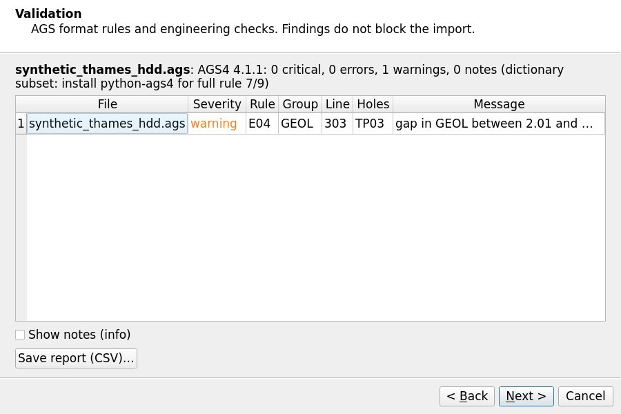
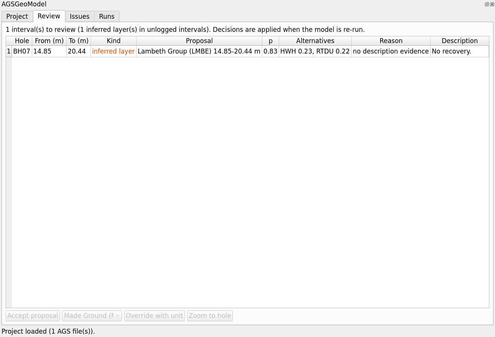
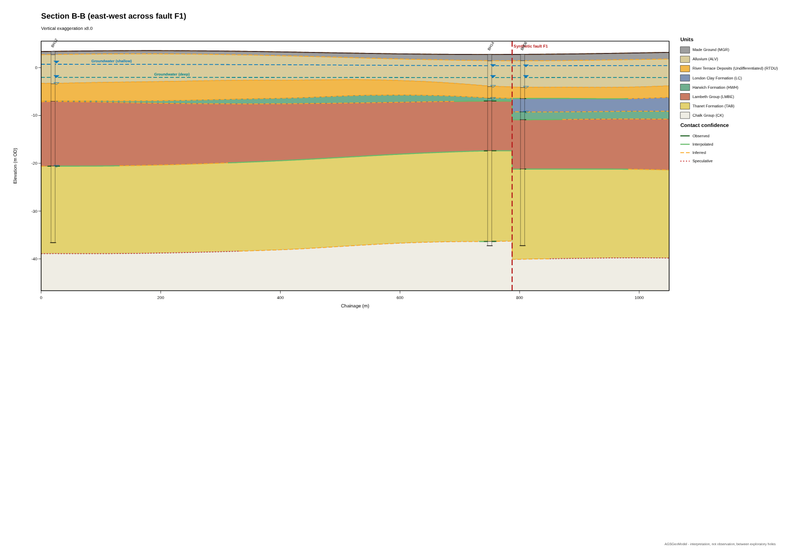
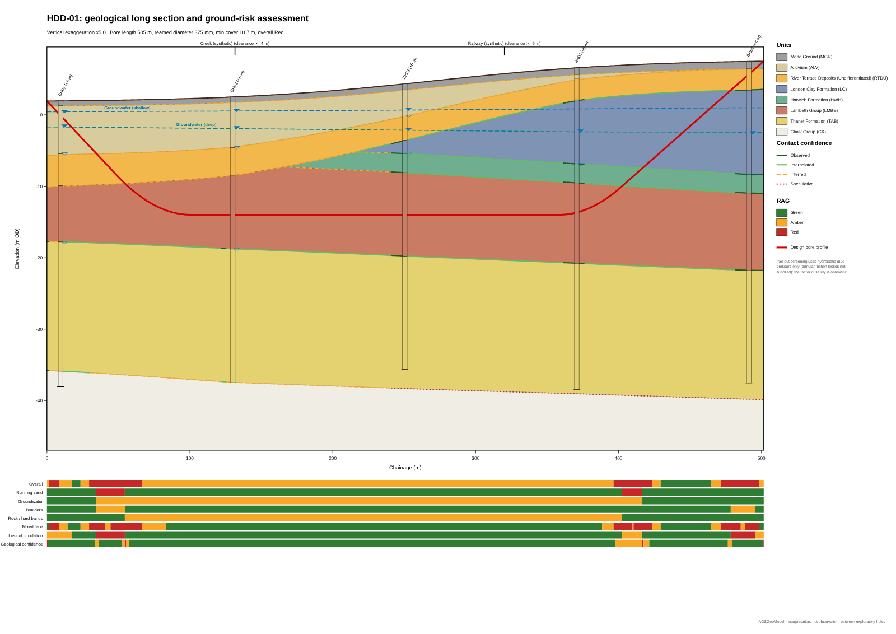

# User guide

This guide follows a project from AGS files to a reviewed ground model, sections and an HDD assessment.
The synthetic example (*Plugins › AGSGeoModel › Create synthetic example project…*) contains every
situation described here: a missing Lambeth Group in an unlogged interval, a wrongly coded Thanet Sand,
chalk fill without the words "made ground", a fault, two aquifers and an HDD crossing.

## 1. Concepts

**Project folder.** Everything for one site lives in one folder: `project.gpkg` (an OGC GeoPackage with
all holes, strata, interpretations, findings and model outputs), `rasters/<run>/` (surfaces as GeoTIFF),
`agsgeomodel_project.json` (the run configuration), drawings, exports and `backups/`. The folder can be
zipped, archived or shared; it opens in any GIS.

**Runs.** Each press of *Run model* is a run with its own id. The configuration, the hash of the inputs,
the knowledge-base version and the random seed are stored, so any output can be regenerated. Earlier runs
are kept until you purge them.

**Interpretation, not observation.** Between exploratory holes everything is interpreted. Every surface
node, section contact and HDD station is classed:

| Class | Meaning | Typical use |
|---|---|---|
| **Observed** | at an exploratory hole that penetrated the contact | design value with normal checks |
| **Interpolated** | inside the investigation, supported by nearby primary data, small standard deviation | design with appropriate caution |
| **Inferred** | extrapolated, supported by secondary data (BGS records, map linework) or with a moderate standard deviation | planning, risk identification; confirm by investigation |
| **Speculative** | no meaningful support | not for design |

The class and a confidence value (0-1, from the standard deviation) are stored with every output and
drawn on every section (contact line style).

## 2. Create a project and import AGS data

1. Open the panel (first toolbar button). In **Project folder** choose an empty folder.
2. Set **Stratigraphy** (the province column used by the GeoReasoner, e.g. *London Basin*; the BGS dialog
   can suggest it) and the **Project CRS** (British National Grid by default).
3. **Add AGS…** or use **Import AGS…** on the toolbar for the import wizard:
   * **Validation** shows every AGS4 format rule finding (AGS4-1 … AGS4-20) and engineering check
     (E00-E15) with group, line and hole. Findings never block the import; critical findings (no LOCA, no
     GEOL) mean the data cannot be modelled. *Save report* writes a CSV.
   * **Coordinates and datum** shows the CRS detected from `LOCA_GREF` / coordinate ranges with its
     confidence and alternatives (e.g. Irish Grid numerically overlaps the British National Grid), the
     vertical datum, and how many holes can be located. Confirm or choose another CRS; an override is stored
     with the project.

## 3. Context data (optional, recommended)

Under **Context data** in the panel choose QGIS layers; they are copied to `inputs/` in the project CRS
when a run starts, so the run can be repeated without QGIS.

| Input | Used for |
|---|---|
| Ground model (DTM) raster | ground surface between holes, levels for holes without `LOCA_GL`, BGS candidate checks |
| Faults (lines) | barriers to interpolation; fields `name`, `throw_m`, `downthrown_side` (`left`/`right` of the digitised direction), `dip_deg`. A fault with throw and side is crossed with a throw correction; without them it is an absolute barrier |
| Superficial / bedrock map (polygons) + code field | map constraints: where a unit is mapped at outcrop it is modelled as present (at least 0.5 m by default) within a positional tolerance that depends on the map scale. Codes must be BGS Lexicon codes (LC, ALV, …). Tick *complete* only if the superficial map is complete (absence outside polygons) |

## 4. Run the model

Press **Run model**. The run happens in the background (*Task manager* shows progress; you can cancel).
On completion the layers are (re)loaded into the *AGSGeoModel* group:

| Layer | Content |
|---|---|
| Validation issues | AGS and geological findings at the holes, coloured by severity |
| Exploratory holes | boreholes, CPTs, trial pits, window samples, dynamic probes, BGS holes (separate symbols) |
| HDD stations / HDD risk zones | RAG per station and contiguous risk zones per hazard |
| Section lines, Faults | traces with labels |
| Groundwater flow, head contours, seepage paths, observations | per aquifer system |
| Surface contours, Uncertainty zones | for the rockhead by default (change the layer filter for other surfaces) |
| Ground domains | artificial / alluvial / glacial / bedrock domains |
| Interpreted units (3D), Logged strata (3D) | vertical sticks per hole for the 3D view; the logged strata carry the reviewer form |
| CPT readings, SPT results, Modelling observations | derived parameters and typed contacts |
| Fence diagram (3D), Model surfaces (3D) | vertical panels and unit tops as 3D triangles |
| Model surfaces (group) | GeoTIFF surfaces of the run (rockhead visible), MDAL meshes |

The *Runs* tab lists the runs and opens the **HTML report** (data and validation summary, stratigraphy,
intervals to review, surfaces with methods and class proportions, sections, engineering ground model,
groundwater, HDD).

## 5. Review the interpretation

The GeoReasoner assigns every logged stratum to a unit of the province column with a probability, the
runner-up alternatives and the evidence (e.g. `GEOL_BGS=TAB (+4.0), geo:TAB (+3.0), pt:sand (+1.8)`). It
flags intervals for review when the probability is low, the description gives no evidence, or an unlogged
interval was split between units (missing-layer inference).

**Review tab.** Each row shows the hole, depth range, kind (*inferred layer* or *low confidence*), the
proposal, probability, alternatives and reason.

* **Accept proposal** records your acceptance (with your name, a reason and the time). It stays valid
  only while later runs propose the same unit sequence; if new data change the proposal, the interval is
  flagged again with *re-review: interpretation changed*.
* **Override with unit** assigns the chosen unit to the whole interval (for example to reject an inferred
  missing layer). Overrides always win and are shown in the *Logged strata* attribute form.
* **Zoom to hole** selects and flashes the hole on the map.

Overrides can also be edited directly in the attribute form of *Logged strata (3D)*: only
`override_unit` (a value map of the column's units), `override_by` and `override_reason` are editable.
Clearing `override_unit` removes the override.

**Issues tab.** Findings with their possible geological explanations (e.g. for an inverted sequence:
logging error, reworked material, reverse faulting, landslip/cambering) and a suggested action. Mark
findings *accepted* or *dismissed*; the status is carried over to the same finding in later runs.

Press **Run model** again to apply the decisions. Every decision is kept in `review_decisions` as an audit
trail.

## 6. BGS geology and boreholes

*BGS geology and boreholes…* (toolbar) analyses the area around the holes for a chosen buffer (100 m,
250 m, 500 m, 1 km, 5 km):

* 1:625 000 bedrock and superficial units with Lexicon links and their share of the search area, mapped
  faults, landslides and map sheets, and a **suggested stratigraphic column** (*Use suggested stratigraphy*);
* the BGS borehole indexes (Single Onshore Borehole Index; AGS data held by BGS), each candidate with a
  **confidence score** and its factors: proximity, value for filling gaps in the investigation, agreement
  with mapped and modelled geology, ground level, age of the record and record quality. Candidates at or
  above the threshold (default 60 %) are pre-selected (*Select qualified*).

*Add to map* writes the candidates (`bgs_boreholes`) and optional 625k vector layers and 1:50 000 WMS layers
to the project. *Download and merge AGS* fetches AGS data for selected candidates held by BGS (AGS API) into
`bgs_ags/` and registers them as **secondary data**: on the next run their contacts get the secondary
positional uncertainty (1 m by default) scaled by the candidate confidence, so they shape the model away
from the site investigation but never override it. Records with scanned logs only can be opened with *Open
log / scan* and digitised if needed.

The 625k mapping is generalised (regional context only). BGS labels its OGC API services BETA. Outputs that
use BGS data carry *"Contains British Geological Survey materials © UKRI"*.

## 7. Cross sections and fence diagrams

*Draw cross section* (toolbar): click vertices on the map, right-click or Enter to finish (Backspace undoes
a vertex, Esc cancels), then give a name, vertical exaggeration and projection corridor. The section is
computed from the stored model in the background and opens in a viewer; SVG and PDF are saved in
`sections/`, the trace in *Section lines*. For many sections at once use the *Cross sections from lines*
algorithm with a line layer.

Reading a section:

* unit polygons in BGS-style colours; **contact line style = uncertainty class** (solid dark green
  Observed, green Interpolated, dashed amber Inferred, dotted red Speculative);
* exploratory holes within the corridor drawn as logs with their offset from the line;
* groundwater heads per aquifer system; faults with labels; crossings (HDD) with required clearances;
* the base of the section is set below the deepest relevant information, not at an arbitrary depth.

Each run also writes sections (those listed in the project configuration, otherwise two automatic
sections along and across the principal direction of the investigation) and a fence diagram connecting
neighbouring holes (2D drawing and 3D panels).

**Correlation and domains.** *Correlate exploratory holes* (Processing › AGSGeoModel › Machine learning)
draws 3D correlation lines between neighbouring holes in one of five modes, from naive equal-elevation
links (for comparison) to rules-constrained links that flag crossing correlations, steep apparent dips and
links across mapped faults. *Cluster holes into geological domains* groups the holes by interpretable
features and explains each group; compare it with the rule-based domains before using it. See
[methods](methods.md#13-correlation) and [machine learning](ai.md).

## 8. 3D view

Open *View › 3D Map Views › New 3D Map View*. *Interpreted units (3D)* (vertical sticks), *Model surfaces
(3D)* (unit tops), *Fence diagram (3D)*, *Exploratory holes* and *HDD stations* have rule-based 3D renderers
with unit / RAG colours and absolute elevations. QGIS does not exaggerate vector layers vertically; for an
exaggerated view use the 3D exports (`vertical_exaggeration` in *Export model and tables*) in ParaView,
PyVista or a glTF viewer.

## 9. HDD and linear infrastructure

Either choose an alignment layer under *HDD / linear infrastructure* in the panel (assessed in every run) or
use *Assess HDD alignment* on the toolbar and digitise it. Parameters: entry and exit angles, bend radius,
design level (or automatic from minimum cover), product outside diameter and ream factor; a layer of
crossed assets with `name` and `min_clearance_m` adds clearance checks.

For every station (1 m spacing by default) the assessment records the unit at the bore and its
probability, cover, distances to the contacts above and below, rockhead, heads per aquifer, the pressure
head at the bore, and a RAG rating for **running sand, groundwater, boulders, rock / hard bands, mixed face
and loss of circulation**, plus the geological confidence. Loss of circulation uses the Delft
cavity-expansion method with parameters from the engineering ground model (or stated assumptions); unless
annular friction losses are supplied the mud pressure is hydrostatic, so the factor of safety is
optimistic (this is printed on the long section). Results: *HDD stations*, *HDD risk zones*, a long section
with RAG strips (PDF/SVG), a CSV per station and a JSON summary in `hdd/`.

## 10. Engineering parameters and groundwater

* **CPT readings**: Robertson (2009/2010) normalisation, Ic and SBTn zone, unit weight, su (Nkt), OCR,
  Dr, φ′, E′ and M, Vs/G0, permeability. Correlations are restricted to the material they apply to (E′ and φ′
  only in coarse soils, su only in fine soils).
* **SPT results**: N60, (N1)60 and correlations by material class.
* **Engineering ground model** (report and table `ground_model_parameters`): per unit and parameter n,
  mean, SD, COV, min/median/max, cautious mean (mean × (1 ∓ COV/2)), 5 % fractile (Student t; lognormal
  for positive quantities), and a depth trend when significant. Choosing characteristic values remains an
  engineering decision (BS EN 1997-1 2.4.5.2).
* **Groundwater**: heads per aquifer system from monitoring readings (full weight) and water strikes (low
  weight), perched water flagged, confinement classes (unconfined, confined, artesian, possible leakage),
  flow vectors and seepage paths.

## 11. Exports

*Export model and tables* writes VTK (units and borehole sticks), VTK voxel block model, OBJ, PLY, glTF,
DXF (3DFACE + polylines, AutoCAD R12) and IFC4 (with `IfcMapConversion` and `IfcProjectedCRS`), and the
project tables as GeoJSON, Shapefile, CSV and one Excel workbook. OBJ/PLY/glTF/IFC coordinates are relative
to the local origin in `export_manifest.json` (large BNG coordinates lose precision in single-precision 3D
formats). The GeoPackage itself is the primary GIS exchange format.

## 12. Settings

*Plugins › AGSGeoModel › Settings…*

* **Modelling**: interpolation (kriging, RBF, IDW, TIN), variogram model, neighbours, drift, faults as
  barriers, map constraints, contact uncertainty for AGS and BGS/legacy data, map tolerance, random seed.
* **GeoReasoner**: review threshold, neighbour elevation prior, unlogged-interval slice length, a learned
  formation model and whether to train one from this project on the next run.
* **BGS services**: cache file and age, offline mode, service URLs (BGS labels its services BETA; URLs can
  be changed without a new plugin release), an optional hydrogeology WMS you are licensed to use.
* **HDD**: station spacing, minimum cover, mixed-face tolerance, frac-out flag ratio.

Project settings are stored in the project folder and recorded with every run; reviewer name and BGS
settings are personal.

## 13. Reproducibility and automation

* Re-run a project folder outside QGIS: `python -m agsgeomodel run <project folder>`.
* Every GUI action is also a Processing algorithm (see the [Processing reference](reference/processing.md)),
  so whole workflows can be built in the graphical modeler or scripted.
* `project.gpkg › model_runs` records each run; `review_decisions` records each reviewer decision.

## 14. Troubleshooting

| Symptom | Cause and remedy |
|---|---|
| "no located exploratory holes" | LOCA has no usable coordinates, or the CRS was not confirmed. Check the import wizard's coordinate page |
| Holes far from where expected | wrong source CRS (e.g. Irish Grid vs British National Grid): override it in the import wizard |
| Many intervals flagged *no description evidence* | descriptions are very short or codes missing; check `GEOL_DESC` / `GEOL_GEOL`; consider a learned model trained on reviewed projects |
| A unit appears where it should not | look at the interval's evidence in *Logged strata* (`evidence` field); override it; check the province column |
| BGS dialog: services could not be reached | proxy/network settings, or use offline mode with a cache |
| Warning about OSTN15 grid | install the grid (see Installation) for exact BNG ↔ WGS84 transformations |
| 3D view looks flat | QGIS does not exaggerate vector layers; use the exports with vertical exaggeration |
